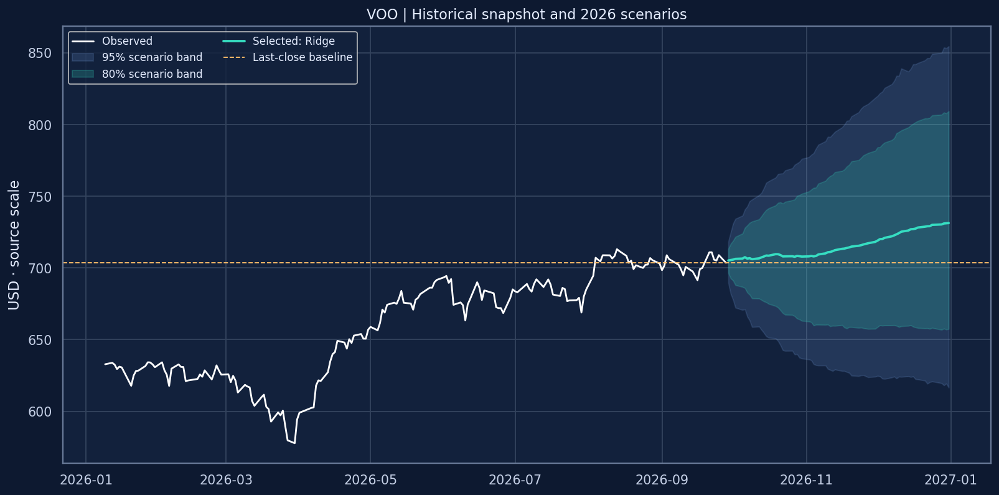

# VOO ETF · Historical Prices, EDA & 2026 Forecast

**Muhammad Ibrahim Shahrukh** · Research snapshot through **September 28, 2026**

A beginner-friendly, reproducible research project using 4,037 daily observations of the Vanguard S&P 500 ETF. Explore interactive dashboards, return tails, drawdowns, volatility, calendar patterns and fixed-origin machine-learning forecasts. The notebook pairs Plotly with static Matplotlib charts for reliable viewing.



## Results from the included execution

| Item | Result |
|---|---:|
| Observed dates | 2010-09-09 to 2026-09-28 |
| Rows / columns | 4,037 / 7 |
| Last supplied close | $703.61 |
| Validation-selected model | Ridge |
| Best ML candidate on validation | Ridge |
| Untouched-test MAE | $16.29 |
| Untouched-test RMSE | $18.62 |
| Untouched-test MAPE | 2.33% |
| Test skill vs last-close MAE | 30.83% |
| Forecast sessions | 66 |
| December 31 path value | $731.34 |
| Year-end 80% simulation range | $657.48–$809.40 |

These figures describe this supplied snapshot and this experiment. **The log-drift baseline performed best on the final test (MAE $8.10), ahead of Ridge; Ridge remains selected because it won the earlier validation comparison.** This limits the evidence for a stable ML advantage. Simulation bands are not calibrated prediction intervals. Read [the generated findings](outputs/research_findings.md) before interpreting the final path. Adjustment flags were not supplied, so neither total-return performance nor an unadjusted price basis is asserted.

## Start here

1. Open `voo_eda_ml_2026_forecast.ipynb` for code, saved results and explanation.
2. Open `voo_research_report.html` in a browser for a self-contained offline report with interactive charts and code.
3. Use `voo_daily_clean.csv` for your own analysis.
4. Read [KAGGLE_DATASET_GUIDE.md](KAGGLE_DATASET_GUIDE.md) for the title, subtitle, description, file description and data dictionary.

## Run locally

Use a new virtual environment with Python 3.11 or newer:

```bash
python -m venv .venv
# Windows PowerShell: .venv\Scripts\Activate.ps1
# macOS/Linux: source .venv/bin/activate
python -m pip install -r requirements.txt
jupyter lab voo_eda_ml_2026_forecast.ipynb
```

Choose **Restart Kernel and Run All Cells**. Keep the clean CSV in the notebook folder. The run is CPU-only and deterministic with seed 42; elapsed time varies by hardware and package versions. The included run used two estimator threads. Re-running writes derived outputs under `outputs/`.

For headless execution in an ordinary Jupyter environment:

```bash
jupyter nbconvert --to notebook --execute --inplace --ExecutePreprocessor.timeout=900 voo_eda_ml_2026_forecast.ipynb
```

The delivered file was actually executed cell by cell in a fresh IPython process because this build environment disallowed kernel sockets. All **14 code cells** completed with **zero error outputs**; the notebook format was validated and plots were inspected. This is not a claim of execution on Kaggle's infrastructure. Details: `outputs/execution_check.json`; dependency versions: `outputs/run_summary.json`.

## Run on Kaggle

1. Review upstream data rights before public redistribution.
2. Upload `voo_daily_clean.csv` as the dataset file, with metadata from the guide.
3. Import the `.ipynb` into a Kaggle notebook and attach the dataset via **Add Input**.
4. Run all cells. The loader recursively finds the exact clean filename, deduplicates paths and refuses ambiguous matches. Set `DATA_PATH` explicitly if several matching files are attached.
5. Outputs appear in `/kaggle/working/voo_outputs`. The notebook does not need internet for data access. If an environment lacks a required library, install the packages from `requirements.txt` before running; no hidden install cells are included.

Each Plotly figure has an HTML representation; static chart companions also appear in the notebook. If a viewer blocks JavaScript, read the static version or download the offline HTML report. Saved notebook outputs remain in version control intentionally.

## Repository files

| Path | Purpose |
|---|---|
| `voo_daily_clean.csv` | Clean historical observations |
| `voo_eda_ml_2026_forecast.ipynb` | Executed EDA and modeling notebook |
| `voo_research_report.html` | Offline interactive report |
| `KAGGLE_DATASET_GUIDE.md` | Copy-ready listing and beginner guide |
| `DATA_PROVENANCE.md` | Collection context, transformations, rights |
| `data_dictionary.md` | Historical column meanings |
| `FORECAST_METHODOLOGY.md` | Validation design, metrics and forecast schema |
| `COVER_IMAGE_PROMPT.md` | Dataset-cover generation prompt |
| `scripts/clean_data.py` | Deterministic raw-to-clean processing |
| `data/raw/voo.csv` | Original upload; bundled but ignored by git |
| `outputs/*.csv` | Audits, comparisons, predictions and diagnostics |
| `outputs/*.json` | Hashes, versions, execution record and findings |
| `outputs/research_findings.md` | Results-linked interpretation |
| `outputs/figures/*.png` | Static chart companions |
| `requirements.txt` | Required notebook and Jupyter dependencies |
| `.gitignore` | Excludes secrets, environments and redundant outputs |

The raw file is included in this downloadable archive for local reproducibility, but `.gitignore` prevents adding it by default. To rebuild the clean dataset, run `python scripts/clean_data.py` from the project folder. The historical CSV, notebook, metrics and PNG figures are intentionally tracked. Individual self-contained chart HTML files are regenerated by the notebook and omitted from the archive; the combined HTML report is included.

## Method and limitations

We forecast cumulative future log changes at every session horizon directly. Ridge, Random Forest and Extra Trees compete with last-close and 252-session log-drift baselines. Four time-ordered validation origins select the lowest mean normalized MAE; a final untouched block checks the chosen model. Training targets must end at or before the origin. Model selection never uses test scores. The final model is then refitted on all observable labels.

Five-session block-bootstrap shocks generate scenario bands around the selected path. These describe historical shock variability, omit parameter and regime uncertainty, and are not promised coverage. Forecasts do not contain future actual OHLCV inputs. The snapshot may include retrospectively revised prices, so full point-in-time data integrity is not established. There is no transaction-cost or portfolio backtest and no guaranteed Kaggle ranking or trading performance.

## Source and reuse

Source attributed by the uploader: [Yahoo Finance](https://finance.yahoo.com/quote/VOO/history/) via [yfinance](https://github.com/ranaroussi/yfinance). Fund: [Vanguard](https://investor.vanguard.com/investment-products/etfs/profile/voo). Scheduled holidays: [NYSE](https://www.nyse.com/trade/hours-calendars). Full details and limitations are in [DATA_PROVENANCE.md](DATA_PROVENANCE.md). No new data or code license is assigned; verify applicable data rights before publication.

## Suggested GitHub metadata

**Repository name:** `voo-etf-prices-eda-2026-forecast`

**Description:** VOO ETF historical price analysis with interactive EDA, time-ordered ML evaluation, 2026 forecast scenarios, and beginner-friendly documentation.

## Feedback

Reproducible improvements are welcome: broader rolling-origin tests, explicit point-in-time adjustment metadata, calibrated uncertainty, and well-timestamped additional features. Please report the dependency versions and a minimal reproducible example with issues.
